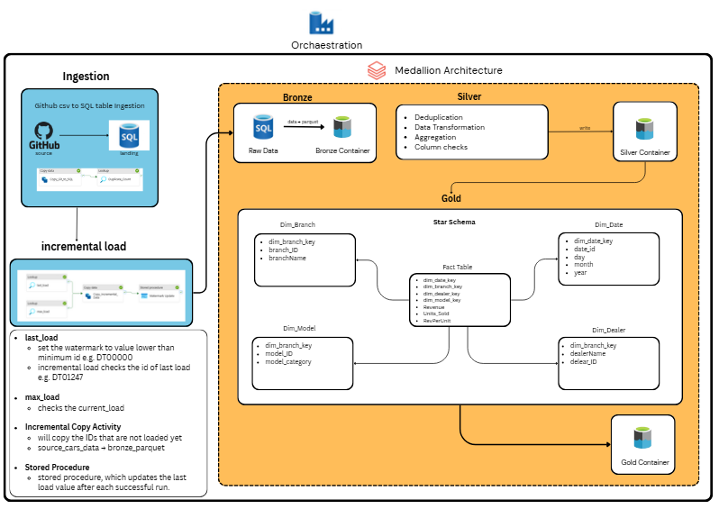

# Azure-Car-Sales-Analytics-Pipeline
## Overview
Scalable Azure data engineering solution showcasing automated data ingestion, incremental processing, and orchestration using Azure Data Factory (ADF) and Azure Data Lake Storage (ADLS). ADF orchestrates data movement from GitHub and SQL Server into ADLS, while a watermark-based incremental loading strategy ensures that subsequent pipeline runs process only new or changed records.

Azure Databricks processes the ingested data through a Bronze → Silver → Gold medallion architecture, where data is cleansed, deduplicated, and transformed into analytics-ready datasets. The Gold layer applies dimensional modeling to create a star schema optimized for downstream analytics, reporting, and business intelligence.

## What this project demonstrates:
- Cloud-based data pipeline orchestration using Azure Data Factory
- Data ingestion from GitHub into SQL Server
- Incremental data loading using a watermark-based pattern
- Pipeline control using ADF Lookup Activities and Stored Procedures
- Cloud data storage using Azure Data Lake Storage (ADLS)
- Efficient analytical storage using Parquet
- Medallion architecture using Bronze, Silver, and Gold layers
- Data transformation and deduplication using Azure Databricks
- Dimensional modeling using a star schema
- Separation of ingestion, transformation, and analytics layers

## How I Built It
1. **Source ingestion**: I ingested the car sales dataset from GitHub into a SQL Server database using an Azure Data Factory Copy Activity.
2. **Watermark table**: I created a watermark table in SQL Server to store the last successfully processed load value, allowing each pipeline run to determine where the previous load stopped.
3. **Incremental boundaries**: I used Lookup Activities in Azure Data Factory to retrieve the previous watermark value and determine the maximum available load value from the source.
4. **Incremental loading**: I configured the pipeline to process only records within the current watermark range, preventing the entire dataset from being reprocessed during every run. This reduces unnecessary data movement, processing time, and compute usage.
5. **Bronze ingestion**: I used a second Copy Activity to move the incremental dataset from SQL Server into the Bronze layer of Azure Data Lake Storage as Parquet files.
6.**Watermark update**: I created the UpdateWatermarkTable stored procedure to update the stored watermark after the successful completion of the incremental load.
7. **Silver transformation**: I used Azure Databricks to read the Bronze Parquet files and perform data cleaning, transformation, and deduplication before writing the refined data into the Silver layer.
8. **Gold dimensional model**: I transformed the Silver data into a Gold-layer star schema consisting of four dimension tables and one fact table, making the dataset ready for analytics and business intelligence workloads.

## Pipeline Architecture


| Medallion term | Equivalent term | Purpose |
|---|---|---|
| Bronze | Landing / Raw | Stores incrementally loaded source data in Parquet format while preserving data close to its ingested state |
| Silver | Cleansed / Curated | Cleans, transforms, and deduplicates Bronze data to create a reliable dataset |
| Gold | Presentation / Analytics | Converts curated Silver data into an analytics-ready dimensional model |

## Design Decisions

1. Why use incremental loading instead of reloading the entire dataset?
Reprocessing the entire dataset during every pipeline run wastes compute and increases runtime as data volume grows. The watermark pattern limits each run to records that fall within the new processing range, making the pipeline more scalable and efficient.

2. Why use a watermark table?
The watermark table maintains pipeline state by storing the last successfully processed value. This gives the next pipeline run a clear starting point and provides a simple mechanism for controlling incremental ingestion.

3. Why update the watermark only after the load succeeds?
Updating the watermark after successful processing prevents the pipeline from advancing its checkpoint before the data has been loaded. If a load fails, the previous successful watermark remains available for the next run.

4. Why store Bronze data as Parquet?
Parquet is a columnar file format that provides efficient storage and high-performance reads for analytical workloads. It is also well suited for distributed processing in Azure Databricks.

5. Why separate Bronze, Silver, and Gold?
Each layer has a different responsibility. Bronze represents ingested data, Silver contains cleaned and deduplicated data, and Gold contains business-ready dimensional models. Separating these responsibilities improves maintainability and makes data-quality problems easier to isolate.

6. Why use a star schema in Gold?
A star schema separates measurable business events from descriptive attributes. The fact_sales table contains the sales records, while the dimension tables provide context such as model, branch, dealer, and date. This structure simplifies downstream analytical queries and BI reporting.

## Incremental Loading Workflow

The Azure Data Factory pipeline uses a watermark-based incremental loading pattern.
Read Previous Watermark
          │
          ▼
Determine Maximum Source Value
          │
          ▼
Filter Incremental Records
          │
          ▼
Copy Incremental Data to ADLS
          │
          ▼
Validate Successful Load
          │
          ▼
Update Watermark Table

The watermark defines the boundary between previously processed data and records that still need to be loaded.

Conceptually, each run processes records using a condition similar to:
```sql
WHERE load_value > @LastWatermark
  AND load_value <= @CurrentMaxWatermark
````

## Technology Stack
| Technology | Purpose |
|---|---|
Github | Source dataset |
SQL Server |	Relational staging/source database and watermark storage|
Azure Data Factory| Data ingestion, incremental loading, and orchestration |
Azure Data Lake Storage	| Cloud data lake for medallion layers |
Parquet	| Columnar storage format |
Azure Databricks	| Data transformation, cleansing, deduplication, and dimensional modeling |
SQL	| Source querying, watermark management, and stored procedures |


